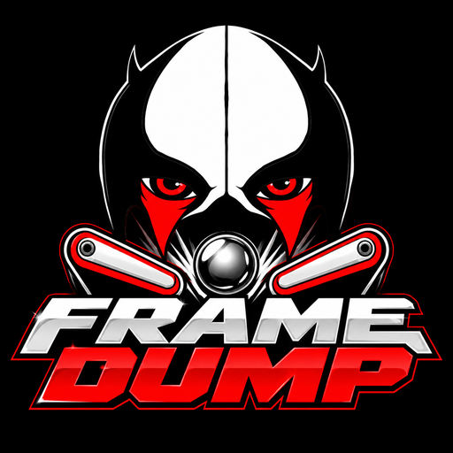

<p align="center"></p>

<h1 align="center">VPin Frame Harvester</h1>
<p align="center">by Syniztah</p>

Colouring a DMD with ColorizingDMD / Serum starts with a dump of every screen the
ROM can show. Normally that means hours of playing the table with dumping
switched on. **VPin Frame Harvester plays the ROM for you.** It runs the game in
PinMAME with no table, presses the buttons and switches like a player would,
keeps every *unique* DMD frame, and exports them as a VPinMAME `.txt` dump that
ColorizingDMD imports directly.

Checked against a finished Sharkey's Shootout colourisation, it reached about
**85 % of the screens** on its own. The rest (deep wizard modes, rare
awards) you can pick up with a normal manual dump and add to the same project.

---

## Download

1. Go to the **[Releases](../../releases)** page and download
   `VPinFrameHarvester-windows.zip`.
2. Unzip it anywhere, for example `C:\VPinFrameHarvester`.
3. Double-click **VPinFrameHarvester.exe**.

You don't need Python for the release version.

## What else you need

- **libpinmame** (the PinMAME library). Download the Windows x64 build from the
  [PinMAME releases](https://github.com/vpinball/pinmame/releases)
  (`libpinmame-…-win-x64.zip`) and unzip it, for example to `C:\libpinmame`.
- **Your ROMs.** Put the ROM zips in `C:\libpinmame\roms\`. ROMs are not
  included and never will be.
- **The table (.vpx)** you want to colour. The harvester reads its script to
  learn the ball trough, kickers, drop targets and so on.

The first time you open the app it asks where `pinmame64.dll` is
(**PinMAME setup** in the top-right corner changes it later).

## How to use it

**Step 1 – Harvest**
1. **Choose** the table (.vpx). The ROM and game file fill in by themselves.
2. Press **Create NVRAM** once per ROM (a 30-second boot so the game has
   settings).
3. Pick how long to play and how many runs, then **Start harvesting**.
   Watch the DMD and the countdown on the right. Each new run only adds frames
   you didn't already have.

**Step 2 – Clean & export**
Removes duplicate score screens (optionally teaching it the score digits) and
writes one `frames.txt` ready for ColorizingDMD.

**Optional – Compare**
Already have a finished Serum project for the table? Compare shows how much the
harvester reached and pictures of the screens it missed.

**Memory maps (optional extra)**
For many ROMs the harvester knows where the game keeps its player, ball,
credits and high scores ([pinball-memory-maps](https://github.com/tomlogic/pinball-memory-maps)).
That lets it lower the high scores so games end in ENTER INITIALS. For a ROM
without one, tick **Find this table's memory map** and do a few Game play runs
(Players on *Mix* helps): the harvester watches the game's memory while it plays
and works the map out itself. Found maps are saved in `games/nvram_maps/found`
and marked as unchecked, and while one is in use your table's saved memory
(.nv) is backed up and put back after every run. Checked against real maps so far:
Sega/Stern Whitestar and Stern SAM (everything found), Data East (ball and
credits; the player number needs real multi-player games).

## Supported systems

| System | Tested with |
|---|---|
| Williams / Bally WPC | Fish Tales, Theatre of Magic, No Good Gofers |
| Data East 128×32 | Jurassic Park |
| Sega / Stern Whitestar | Sharkey's Shootout, South Park, Harley-Davidson |
| Gottlieb System 3 | Rescue 911 |
| Capcom | Breakshot |

Other DMD systems (Data East 128×16, Sega 192×64, Stern SAM, Alvin G.) should
work but haven't been tested yet. Alphanumeric games (System 11, System 80) have
no DMD, so there's nothing to harvest.

If your table isn't listed, it will still try: it builds a game file from the
table script. Reports and pull requests for new tables are very welcome.

## Running from source

Python 3.10 or newer on Windows:

```
pip install -r requirements.txt
Harvester.bat
```

Double-click `Create desktop shortcut.bat` once for a desktop icon.
Command-line use and how it all works: [docs/TECHNICAL.md](docs/TECHNICAL.md).

## Credits

- Made by **Syniztah**. Free to use. MIT licence (see `LICENSE`).
- Score memory locations from
  [pinball-memory-maps](https://github.com/tomlogic/pinball-memory-maps) by
  Tom Collins, under the Open Database License (see `games/nvram_maps`).
- Runs on [libpinmame](https://github.com/vpinball/pinmame) from the PinMAME
  team.
